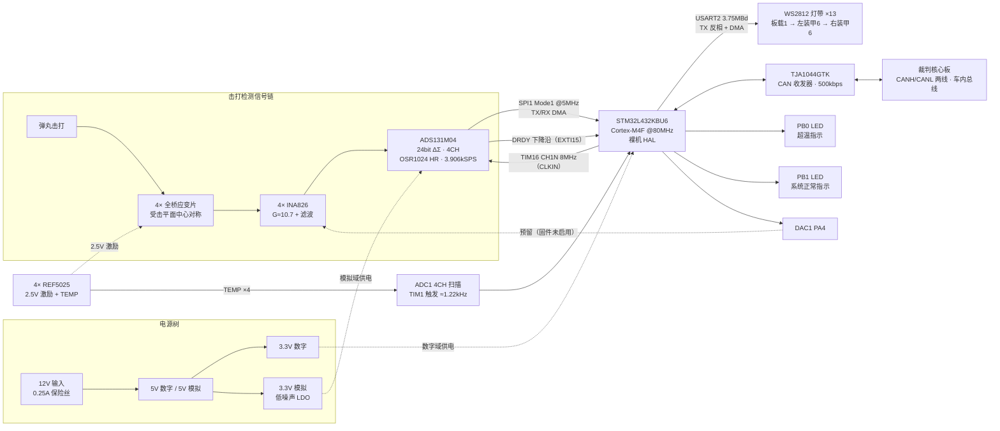
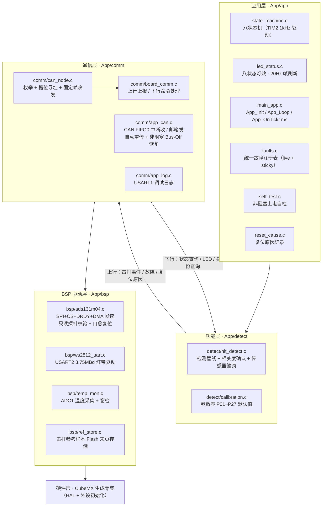

# 装甲模块介绍（Armor_Cmzy26_081）

> 本文档面向模块功能与能力介绍；完整设计（14 章：需求、寄存器级驱动、算法推导、协议、风险清单）见《装甲模块固件设计方案》。引脚/寄存器的权威定义以 CubeMX `.ioc` 为准。

## 1. 模块定位

对标 RoboMaster 2025 裁判系统**装甲板模块**的自研实现（硬件 rev 080/081）：检测弹丸击打、按官方语义驱动装甲灯带、经车内 CAN 总线与裁判核心板通信。作为车队自研"车内总线"节点，模块不直连官方裁判系统，仅与车队核心板通过 CAN 500kbps 固定帧协议交互。

模块 = 1 块主控板（STM32L432KBU6 @80MHz，裸机 HAL，无 RTOS）+ 4 个应变传感区 + 灯带（板载 1 颗 + 左右装甲板各 6 颗，共 13 颗 WS2812），经裁判系统 6 脚连接器接入（信号线仅 CANH/CANL 两线）。

## 2. 硬件组成

硬件框图：

| 部分 | 方案 | 说明 |
|---|---|---|
| 传感 | 4× 全桥应变片 | 中心对称分布，四通道融合检测 |
| 模拟前端 | 4× INA826（G≈10.7）+ RC 滤波 | 放大器输出接 ADC 正端，直流偏置共用接负端 |
| 量化 | ADS131M04 | 24bit ΔΣ、4 通道、3.906kSPS（OSR=1024/HR），内部 VREF=1.2V |
| 主控 | STM32L432KBU6 @80MHz | Cortex-M4F，裸机 HAL |
| 灯 | WS2812 灯带 ≤13 颗（GL5050） | USART2 3.75MBd + TX 反相 + DMA，GRB 序 |
| 通信 | CAN1 + TJA1044GTK | 500kbps 车内总线 |
| 指示 | PB0 / PB1 板载 LED | PB0=超温指示、PB1=系统正常指示 |
| 电源 | 12V → 5V → 3.3V 数字/模拟双链 | 模拟域低噪声 LDO；4× REF5025 提供 2.5V 电桥激励与温度监测 |

## 3. 核心功能

### 3.1 击打检测

- **四通道融合模型**：一次击打在四通道同时产生响应，检测以四通道分力之和（合力）为判定信号——合力与击打位置无关，单次击打天然只产生一个事件。
- **处理管线**：逐通道 EMA 基线跟踪（τ≈2.1s，抑制安装形变/温漂/姿态变化）→ 高通去直流 → 差分高通（抑制 0.1~10Hz 低速摆动误报，冲击边沿无损）→ 合力合成 → 32 样本窗口峰值 → 阈值 + 持续判定（≥1.02ms）→ 锁帧 128 样本合力窗 → 与 Flash 参考样本归一化互相关（P27 相关度门限，形状不符即拒）→ 50ms 不应期 → 沉降门控（机械余振衰减前不重新武装，杜绝一次击打计两次）。
- **检测能力**：最高 20Hz 连发、最小检测力 19N、最大承受 490N（阈值与力度经砝码两点标定）。
- **事件内容**：合力峰值、强度（0–100%）、力度（0.01N）、四通道峰值分布（反映击打位置）、时间戳。
- **端到端时延** <20ms（触发 1.02ms + 确认窗 16.4ms + 上报 <1ms）。

### 3.2 灯光指示

与官方语义对齐的八状态灯效（帧刷新 20Hz）：

| 状态 | 灯效 | 板载 LED |
|---|---|---|
| NORMAL（正常） | 队色常亮 | PB1 亮 |
| HIT（击打） | 队色 5Hz 快闪 | PB1 亮 |
| ID_SETUP（ID 设置） | 队色 1Hz 慢闪 | PB1 亮 |
| FAULT（故障） | 按故障类别出图案（传感器红蓝交替 / 采集链路琥珀 / 欠压白单闪 / 温窗青闪 / 超温粉红常亮） | PB1 灭；PB0 超温时亮 |
| COMM_LOST（通信失败） | 紫色常亮 | 灭 |
| ID_CONFLICT（ID 冲突） | 红蓝紫循环 | 灭 |
| BOOT（自检） | 白色 300ms | 灭 |
| REF_PENDING（上电校准·热身） | 紫色 1Hz 慢闪 | 灭 |
| REF_PENDING（上电校准·探测窗） | 紫色 5Hz 快闪 | 灭 |

**上电流程**：白灯 300ms → **紫 1Hz 慢闪**（基线滤波热身 5τ≈10.5s，此间击打照常计数/上报，
但不做相关度判拒、也不固化参考——窗内样本不纯）→ **紫 5Hz 快闪**（20s 击打探测窗，等第一次
正常击打记录参考样本）→ 队色常亮。三条提前退出路径：① 训练完成；② 上位机上线（收到任一
电管→装甲板报文）且 Flash 有旧参考 → 立即结束校准（BOOT 阶段被打断则白灯后直接进 NORMAL，
不闪紫）；③ 热身 +20s 超时且有旧参考 → 沿用 Flash 旧值。Flash 为空时只剩"训练完成"一条路，
不会超时退出。

队色与发射机构统一（红队粉、蓝队湖蓝），全局亮度可调（0–100%）。

### 3.3 CAN 通信

- **物理层**：CAN 500kbps（采样点 87.5%）；枚举帧 `0x120~0x123`，业务帧 `0x130 + (NodeID−1)×0x10 + offset`（以《装甲模块 CAN 通信协议》v1.5 为准）。
- **协议栈**：固定帧协议——四块同固件装甲板由核心板按 UID 分配运行时 NodeID 1~4，业务帧按节点槽位收发；无分帧、无 TLV、无独立重试调度器。
- **上行**：异常复位原因、运行故障状态、初始化完成、有效击打事件（等 ACK，100ms 重发同一 sequence）、状态回复；**下行**：状态查询、LED 控制、NodeID 身份查询、击打 ACK。参数读写、ID 设置、自检触发、零偏标定尚未实现。
- **掉线管理**：300ms 未收到寻址到本板槽位的请求 → COMM_LOST 紫灯，恢复自动回 NORMAL（枚举帧不计入心跳）。
- **死总线鲁棒**：开启 CAN 自动重传（NART=0），超时/Bus-Off 时主动 abort 邮箱释放，单帧阻塞上限 5ms；Bus-Off 寄存器级非阻塞恢复；发送以 TXOK 判真实成败。
- **中断隔离**：DRDY EXTI（优先级最高）> CAN 错误中断——无总线时的 CAN 错误中断风暴不影响采集链路。

### 3.4 健康监测与自检

- **故障诊断**（统一 16 位故障注册表，状态机/灯效/CAN 上报共用一份真相源）：live 域——通道饱和/偏置异常/死通道、基准温度出窗、超温（5s 去抖）；sticky 域——SPI 错误/DRDY 停滞/ADC 初始化失败、PVD 欠压，仅自检通过或复位可清。
- **温度监测**：4 路 2.5V 基准芯片 TEMP 引脚经 ADC 扫描（≈1.22kHz 硬件触发），兼作板温代理，超温告警联动板载 LED。
- **自检**（上电自动触发，FAULT 态且 sticky PVD 欠压时每 5s 自动重试）：寄存器回读（ID/MODE/CLOCK）、1s DRDY 频率窗（3906±20%）、256 帧（≈66ms）噪声/基线统计、温度窗检、SPI 错误/跳帧增量检查；非阻塞，全程 ≈1.1s，通过即清除 sticky 故障位。
- **采集链路自愈**：ADC 初始化采用「自愈复位序列 + 只读探针校验 + 全量配置写入（不写 MODE 寄存器）」，跨 MCU 复位可自动恢复异常状态，不依赖外部同步引脚与断电。

### 3.5 参数管理与标定

- **参数表** P01~P27：检测阈值/时间常数、灯效、通信周期、保护阈值等；当前只支持编译期默认值（`Cal_GetDefaults()` 为唯一来源），CAN 在线读写尚未实现。
- **标定**：19N/100N 两点力度标定（合力模型，加载位置无关）、通道一致性归一化、通道极性校对（实测固化）。当前 `K_N` 尚未标定（默认 0，力度/强度字段按 0 上报）。
- **持久化**：目前只有击打参考样本落 Flash 末页（2KB 单页：magic + 版本 + ≤128 个 Int32 样本 + CRC32，单份存储）；参数表/极性掩码/零偏基线的 Flash 双槽持久化尚未实现（`Cal_Load`/`Cal_Save` 为 TODO），每次上电恢复固件默认值。

## 4. 固件架构

固件框图：

| 上下文 | 工作 |
|---|---|
| DRDY EXTI（优先级最高 0） | 每 256µs 启动一次 SPI+DMA 帧读取 |
| DMA 完成中断 | 帧入 K=32 环形缓冲（8.2ms 预触发历史） |
| TIM2 1kHz 中断 | 状态机步进、灯效相位、健康评估（只计算+置标志） |
| 主循环 | 帧消费 → 检测管线 → 事件输出 → 协议入队/日志（非阻塞环形） |

## 5. 关键指标

| 指标 | 值 |
|---|---|
| 采集 | 4 通道 24bit @3.906kSPS（帧周期 256µs），单帧 SPI 传输 28.8µs 占采样周期 11%，CPU 开销 ≈0.8% |
| 击打事件端到端时延 | <20ms（触发 1.02ms + 确认窗 16.4ms + 上报 CAN <1ms） |
| 检测范围 | 19N~490N，最高 20Hz 连发 |
| 灯效 | 13 颗 WS2812，20Hz 帧刷新，八状态语义 |
| 通信 | CAN 500kbps 固定帧协议，电管 25ms 轮询一块（每板 10Hz），掉线判定 300ms |
| CPU 负载 | ≈5~6%（80MHz） |
| RAM 占用 | ≈14KB / 64KB |
| 供电 | 12V 输入（0.25A 保险丝） |

## 6. 预留扩展能力

- **波形捕获**：击打触发时冻结环形缓冲窗口（预触发 + 触发后各 16.4ms，合计 32.8ms），输出完整冲击波形供核心板二次处理。
- **击打位置估算**：由四通道峰值分布反推击打位置（接口已预留）。
- **弹速/入射角反推**：冲量–撞击时间联合估计（接口已预留，需实弹标定）。
- **采样率可调**：OSR 降档可提升至 7.8k/15.6kSPS（参数在线切换）。
